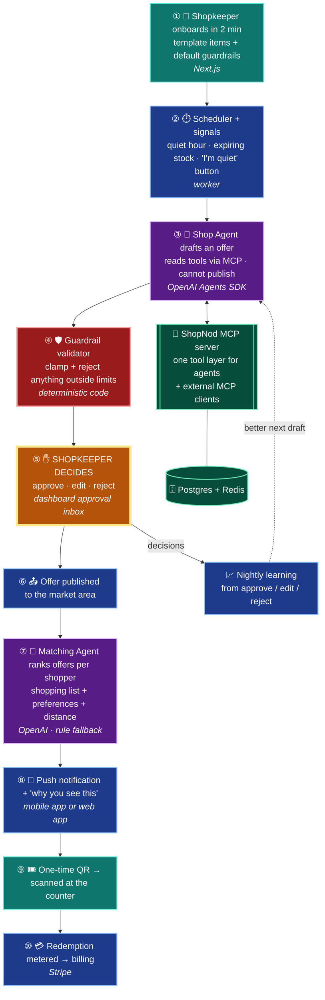
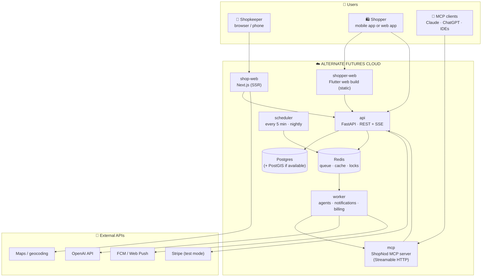
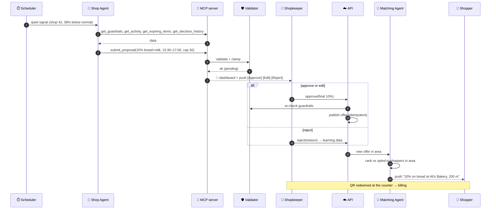
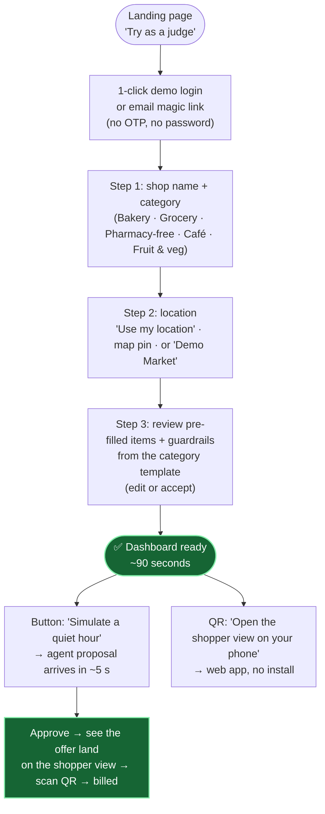

# ShopNod: End-to-End Architecture (v2)

> **One line:** when a local shop is quiet or has stock about to expire, an AI agent drafts an offer inside the shopkeeper's limits. **Nothing goes live until the shopkeeper approves it**, and then only nearby shoppers who'd want it are notified.

Companion docs:
- [tech-stack.md](tech-stack.md)
- [features.md](features.md)
- [rubric.md](rubric.md) (how we score against the judging rubric)
- [compliance.md](compliance.md) (international law)

**What changed in v2:**
- The backend deploys as containers on the **Alternate Futures** cloud platform.
- **OpenAI** replaces the on-device LLM as the default.
- **Agents + an MCP server** handle automation.
- **Human-in-the-loop is enforced in code**, not only in the UI.
- There's a **2-minute judge onboarding** flow.

---

## 1. Design principles

| # | Principle | How the system enforces it |
|---|---|---|
| 1 | **The human approves the money** | The AI agent has **no tool that can publish an offer**. Publishing is only possible through an approval endpoint that needs the shopkeeper's own session or signed approval link. Guardrails are checked again on the server at approval time. |
| 2 | **The AI works inside limits it can't change** | Guardrails (minimum price, maximum discount, budget, blocked items) are hard constraints. The agent can read them but not write them, and every proposal is clamped and validated before it reaches the shopkeeper. |
| 3 | **Works end to end even when things fail** | If OpenAI is down, the system falls back to rule-based proposals and ranking. Messaging uses retries and an outbox. Every external call has a timeout, and every write is idempotent. |
| 4 | **Collect as little personal data as possible** | No customer accounts. Shoppers use an anonymous install ID, location is used only at request time and coarsened, and data expires and can be deleted. |
| 5 | **Lawful in every market** | Consent first, truthful discounts, no personalised prices, AI transparency. See [compliance.md](compliance.md). |
| 6 | **Judges can set up a shop in under 2 minutes** | One-click demo login, category templates, a seeded demo market, and simulated shoppers. |

---

## 2. System overview

**Colour key:** 🟩 shopkeeper · 🟧 the human decision · 🟪 AI agents · 🟥 hard guardrail · 🟦 backend · 🟢 tool layer / storage

---

## 3. Deployed services (all on Alternate Futures)

Every box below is one Docker container. All configuration comes from environment variables, so the same images run locally (`docker compose up`) and on the platform.

| Service | What it does | Scaling |
|---|---|---|
| `api` | REST API for both apps, auth, approval endpoint, redemption, Stripe webhooks, `/healthz` + `/readyz` | Stateless, run 2+ replicas |
| `mcp` | ShopNod MCP server: the **only** way agents touch shop data. Also open to shopkeepers' own MCP clients using a personal token. | Stateless |
| `worker` | Runs the agents, notification outbox, billing jobs, nightly learning (task queue on Redis) | Scale with load |
| `scheduler` | Enqueues periodic jobs: quiet detection (every 5 min), expiry sweep, nightly learning, billing | **Exactly 1 replica** |
| `shop-web` | Next.js shopkeeper app | Stateless |
| `shopper-web` | The same Flutter app built for the web, so judges can try the shopper side **without installing anything** | Static |
| `postgres`, `redis` | Platform-managed if Alternate Futures offers them, otherwise containers with persistent volumes | n/a |

> **To confirm with the organisers** (I couldn't find public docs for Alternate Futures):
> - Does it run Docker images or need specific buildpacks?
> - Are managed Postgres/Redis available, and does Postgres have PostGIS?
> - How are secrets set?
> - Is there a custom domain + HTTPS?
> - Does it support long-running workers and a single-instance scheduler?
> - Can it expose WebSockets/SSE?
>
> If PostGIS isn't available, the design falls back to geohash columns plus Haversine distance in SQL.

---

## 4. Agents, tools and MCP (automation depth)

### 4.1 One tool layer: the ShopNod MCP server
All AI agents access the system **only** through MCP tools. The same server is open to external MCP clients, so a shopkeeper can also say "show my pending offers" in Claude or ChatGPT.

| MCP tool | Who can call it | What it does |
|---|---|---|
| `get_shop_profile` | Agents, shopkeeper | Shop, hours, categories |
| `get_guardrails` | Agents (read-only), shopkeeper | Limits the agent must respect |
| `get_activity(shop, window)` | Agents, shopkeeper | Redemptions, manual signals, baseline |
| `get_expiring_items(shop)` | Agents, shopkeeper | Stock expiring today/tomorrow |
| `get_decision_history(shop)` | Agents | Past proposals and what the human did, used for learning |
| `submit_proposal(shop, items, pct, window, reason)` | **Agents only** | Creates a **pending** proposal. Validated and clamped. **Cannot publish.** |
| `list_pending_proposals(shop)` | Shopkeeper | Inbox |
| `approve_proposal(id, final_pct?)` | **Shopkeeper only** (personal token + confirmation) | The **only** publish path through MCP |
| `reject_proposal(id, reason)` | Shopkeeper only | Rejection with a reason (learning data) |
| `get_offer_stats(offer)` | Shopkeeper | Reach, redemptions, results |

**Human-in-the-loop enforced in code:**
- Agent credentials carry the scope `agent:propose` only.
- `approve_proposal` requires `shopkeeper:approve` plus a fresh confirmation: a dashboard click by the logged-in shopkeeper.
- The server rejects any approval outside the guardrails, even from the shopkeeper's own client. They have to change the guardrail first, deliberately.

### 4.2 The agents

| Agent | Trigger | Tools / steps | Output | If OpenAI fails |
|---|---|---|---|---|
| **Shop Agent** (proposer) | Quiet signal, expiring stock, "I'm quiet" button | Reads profile, guardrails, activity, expiring items, decision history → writes reasoning → `submit_proposal` | A pending proposal with a plain-language reason | Rule-based proposal (e.g. "learned average % for this category", clamped) |
| **Onboarding Agent** | Shopkeeper pastes a price list or uploads a photo of one | Extracts items, prices and categories → suggests guardrails | A **draft** item list + guardrails for the shopkeeper to confirm | Category template only |
| **Copy Agent** | Proposal approved | Short offer text in the shop's languages, factual only (no invented claims) | Offer text | Template text |
| **Matching Agent** | Shopper opens the app or enters a market area | Ranks active offers in the area against the shopper's list and preferences (structured output: score + reason) | Top 1–3 offers + "why you see this" | Keyword/category + distance scoring |

All agent outputs use **structured outputs (JSON schema)**. Invalid output is retried once, then the fallback is used. Every agent run is logged (inputs, tools called, output, latency, cost) for the "agent trace" view in the dashboard.

---

## 5. Key flows

### 5.1 Quiet shop → approval → shopper

### 5.2 Redemption
1. The shopper taps **Get offer**. The API creates a signed, one-time token tied to the offer and the anonymous install ID, and the app shows it as a QR code.
2. The shopkeeper scans it in the dashboard (browser camera). The API checks the signature, expiry, shop and that it hasn't been used. The check is idempotent, so scanning twice is safe.
3. The redemption is recorded and metered for billing, and the shopkeeper sees "✅ apply 10%".

### 5.3 Learning from the human
- Every proposal stores what was **proposed** and what the shopkeeper **did**: approve, edit to X%, or reject with a reason.
- A nightly job updates each shop's learned preferences (per-category discount, accepted hours). The Shop Agent reads them through `get_decision_history`.
- The dashboard shows an **approval-rate-over-time** chart: proof the AI is learning from the human.

---

## 6. Judge onboarding (under 2 minutes)

- **Demo market:** a seeded area with 5 sample shops and simulated shoppers, so a single judge can see the whole loop without other users.
- **Reset:** "Reset my demo shop" restores the template state.
- **Sandbox safety:** demo shops are flagged `is_demo`, never shown to real shoppers, and billed in Stripe test mode only.

---

## 7. Reliability and error handling (rubric: technical execution, 25 pts)

| Area | What we do |
|---|---|
| External calls | Timeouts on every call, retries with exponential backoff and jitter, and a circuit breaker per provider (OpenAI, push, Stripe) |
| AI failures | Structured outputs, schema validation, one retry, then a deterministic fallback. The loop never stops because of the AI. |
| Exactly-once effects | Idempotency keys on approve, publish, claim, redeem and the Stripe webhook. Unique constraints in Postgres. |
| Notifications | **Transactional outbox:** messages are written in the same database transaction as the state change, then sent by the worker with retries. |
| Concurrency | Row locks on proposal approval and redemption. A Redis lock makes sure only one Shop Agent runs per shop. |
| Webhooks | Signature verification (Stripe), replay protection |
| Input validation | Pydantic on every endpoint, Zod in the web forms |
| Health | `/healthz` (process up) and `/readyz` (DB, Redis and queue reachable). The platform restarts unhealthy containers. |
| Observability | Structured JSON logs with a request ID, Sentry, and an agent trace table (tool calls, latency, cost) |
| User-facing errors | Clear messages and retry buttons ("Couldn't reach the AI, a rule-based suggestion was used instead") |
| Tests | Unit tests (validator, guardrails, tokens), API tests, and **one Playwright end-to-end test of the whole loop**, run in CI on every push |
| Data safety | Daily database backups (platform or `pg_dump` job), migrations with Alembic, run on deploy |

---

## 8. Revenue streams

| # | Stream | Who pays | Metered by |
|---|---|---|---|
| 1 | **Pay per redemption** (main) | Shopkeeper | QR scans only. No customer means no fee. |
| 2 | **Pro subscription** | Shopkeeper | Plan in Stripe: unlimited offers, auto-approve rules, WhatsApp alerts, multi-language copy, analytics |
| 3 | **Brand-funded offers** | FMCG brands and distributors | A brand funds discounts on its products, and the **shopkeeper still approves** each campaign. Platform fee per redemption. |
| 4 | **Area demand insights** | Brands, distributors | Aggregated, anonymous, minimum-threshold data from shops and redemptions only. **Never customer profiles.** |

The prices are hypotheses to test, not researched figures. Payments use Stripe in test mode for the hackathon, with local payment methods added per market later.

---

## 9. Privacy and compliance summary

Full detail in [compliance.md](compliance.md).
- **Shoppers:** no account, anonymous install ID, opt-in location and notifications, location coarsened and not stored as history, shopping list stored only if the user opts in, deletion in one tap, data expires automatically.
- **Same price for everyone:** an offer has one price for every shopper who sees it. The AI personalises *which* offers you see, not *what you pay*. This avoids personalised-pricing rules and fairness problems.
- **AI transparency:** AI-written text is labelled, and every notification shows "why you see this".
- **OpenAI:** data minimisation (no names, no precise location sent), a data processing agreement, and API data not used for training. Confirm OpenAI's current terms.

---

## 10. Hackathon MVP scope

| In the demo | Later |
|---|---|
| Judge onboarding + demo market + simulated shoppers | Real multi-city launch |
| Shop Agent via MCP tools + validator + approval (dashboard) | WhatsApp approvals |
| Matching Agent + push to the web/mobile shopper app | On-device LLM "privacy mode" (Gemma) |
| QR redemption + Stripe test-mode metering | Real payouts, local payment methods |
| Approval-rate chart, agent trace view | POS integrations, brand campaigns |
| Deployed on Alternate Futures, health checks, an end-to-end test | Autoscaling, multi-region |
